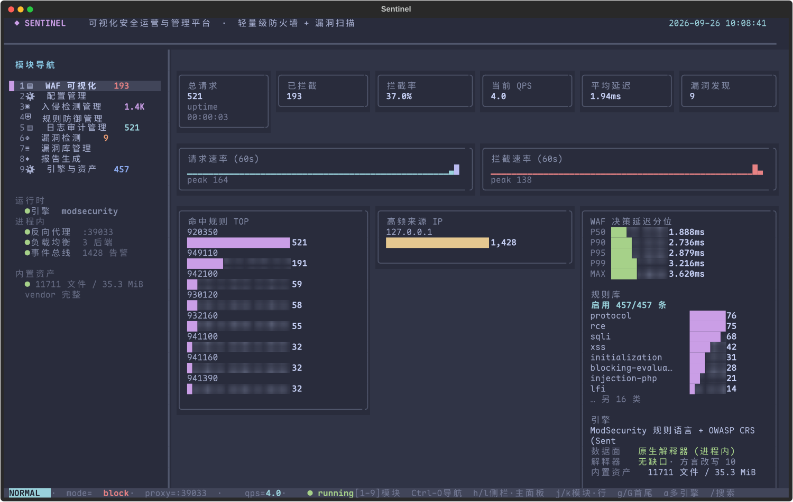
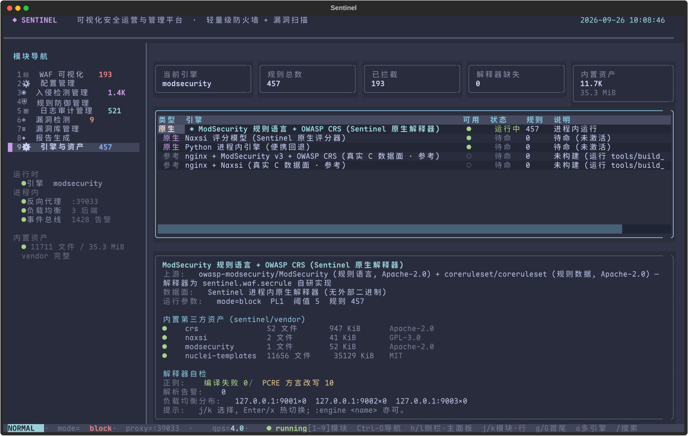

[English](README.md) | 简体中文

# Sentinel · 安全运营与管理控制台

> 轻量级防火墙 + 漏洞扫描子系统 + TUI
> —— **引擎、规则语言解释器与模板解释器**。

WAF 端实现了 ModSecurity 规则语言解释器，执行真实 OWASP CRS 规则。实现 Naxsi 评分模型，解释 nuclei 的 YAML 模版。

```
                    ┌────────────────────────────────────────────────┐
                    │  组件 III · 安全运营与管理控制台               │
                    │  sentinel.tui  ·  Textual + Catppuccin Frappé  │
                    └───────────────┬────────────────────────────────┘
              ┌─────────────────────┴──────────────────────┐
              ▼                                            ▼
 ┌───────────────────────────┐             ┌───────────────────────────────┐
 │ 组件 II · WAF 防火墙      │             │ 组件 I · 漏洞扫描器           │
 │ sentinel.waf              │             │ sentinel.scanner              │
 │  解析 → 归一化 →          │             │  侦察 → 检测 → 漏洞库 →       │
 │  规则 → 拦截              │             │  报告                         │
 │  ▸ SecRule 解释器         │             │  ▸ 模板解释器                 │
 │  ▸ Naxsi 评分器           │             │  ▸ 插件扫描器                 │
 │  ▸ 内置规则集             │             │  ▸ 内置检测器 (10)            │
 └───────────┬───────────────┘             └───────────────┬───────────────┘
             └────────────────────┬────────────────────────┘
                                  ▼
                ┌────────────────────────────────────┐
                │ 后端靶场  ·  sentinel.lab          │
                │ 多实例，预留漏洞                   │
                │ (SQLi / XSS / SSRF / LFI)          │
                └────────────────────────────────────┘
```

<sub>`组件 I / II / III` 是本站为之构建的课程项目所要求的三大部分
（扫描器 / 防火墙 / 管理控制台）；它们与
`sentinel.scanner` / `sentinel.waf` / `sentinel.tui` 一一对应。</sub>

## 目录

- [设计说明：从调用到实现](#设计说明从调用到实现)
- [架构映射](#架构映射)
- [第三方内置资产](#第三方内置资产)
- [快速开始](#快速开始)
- [TUI](#tui)
- [快捷键与命令](#快捷键与命令)
- [测试与基准](#测试与基准)
- [项目结构](#项目结构)

## 设计说明：从调用到实现

早期版本把 `nginx + libmodsecurity` 和 `nuclei` 二进制当作要"驱动"的黑盒：
Sentinel 生成配置、监管进程并跟踪日志。这样能跑起来，但**你的上限就成了上游的
上限**——而一旦某个同级目录被重命名、你换了机器，或者某个 Go 二进制缺失，整个
平台就会悄无声息地失效。

如今这部分能力已经存在于本仓库中。其中最关键的有三部分：

### 1. ModSecurity 规则语言解释器 (`sentinel/waf/secrule/`)

它自己解析 `SecRule` / `SecAction` / `SecDefaultAction` / `SecMarker`，并实现
变量空间（`ARGS` / `REQUEST_HEADERS` / `TX` / ……）、运算符
（`@rx` / `@pmFromFile` / `@detectSQLi` / `@ge` / ……）、变换
（`t:urlDecodeUni` / `t:cmdLine` / ……）以及动作（`setvar` / `ctl` / `chain` /
`skipAfter` / `capture`）。随后它从 `sentinel/vendor/crs` 加载**真实的 OWASP CRS
规则**：

```python
from sentinel.core.config import Config
from sentinel.waf.engines import ModSecurityEngine

driver = ModSecurityEngine(Config())      # 加载 457 条请求侧 CRS 规则（阶段 1/2）
decision = driver.inspect(request)        # -> Decision(verdict/score/matched_rules)
```

ModSecurity 规则语言包含一系列**反直觉、且会静默失效的语义**。每一条都与 C 实现
逐一比对，并用回归测试固定下来（见 `tests/test_secrule.py` 和
`sentinel/waf/secrule/syntax.py`）：

| 语义 | 直觉上的读法 | 实际行为 |
| --- | --- | --- |
| `@validateByteRange` / `@validateUtf8Encoding` / `@validateUrlEncoding` | 合法时匹配 | **校验失败时匹配** |
| `&TX:x` | 读取变量 | 读取**匹配计数**（未设置时为 0） |
| `A\|!A:x` | 对 A:x 取反 | 从累积集合中**移除** A:x |
| `SecDefaultAction "…,pass"` 下的 `block` | 阻断 | **仅计分**；阻断来自 `REQUEST-949` 的 `deny` |
| 偏执等级 (Paranoia Level) | 过滤规则集 | 通过 `skipAfter` + `SecMarker` 实现的**按等级跳转** |
| `TX` 键大小写 | 区分大小写 | **不区分**（CRS 写 `tx.` 却读 `TX.`） |

PCRE 与 Python `re` 之间的方言差异也做了处理（`\x{bf}`、`(?|…)`、`[\--9]`、
模式中间的 `(?i)`），而且这些改写**只在 Python 无法编译该模式时才生效**——因此
本来就正确的规则永远不会被改动。引擎如实报告改写次数：

```
interpreter self-check   regex: 0 compile failures / 10 PCRE dialect rewrites
```

### 2. Naxsi 评分器 (`sentinel/waf/naxsi/`)

Naxsi 的模型与 ModSecurity 完全不同，因此它拥有独立的实现：解析 `MainRule` 的
`mz:`（检查面）与 `s:$SQL:4`（按键计分），并依据 `CheckRule` 阈值做出判定。6 个
评分键共 46 条核心规则，阈值从 PL1 到 PL4 逐级收紧。

### 3. nuclei 模板解释器 (`sentinel/scanner/templating/`)

它自己解析并执行 nuclei 的 YAML 模板：`method` / `path` / `raw` / `headers` /
`body` / `payloads` / `attack`（sniper · pitchfork · clusterbomb · batteringram）、
匹配器（status · size · word · regex · binary · dsl）、提取器
（regex · kval · json · dsl）、`{{...}}` 插值以及 DSL 函数。模板数据为官方
`nuclei-templates`（内置 11,309 个 HTTP 模板）。

DSL 使用 `ast` 白名单求值，而非 `eval`——模板来自第三方仓库，直接执行它们将导致
任意代码执行（`tests/test_templating.py` 中有拒绝用例）。

**只会扫描你指定的目标。** 官方模板中包含若干 SSRF/OAST 探测，它们在 `path` 中
硬编码了外部主机（`169.254.169.254`、`*.oast.pro`、
`generativelanguage.googleapis.com` 等）。默认情况下只有被扫描的主机可达；其余
一律跳过并计数（在扫描面板中显示为 `blocked_external`）。这既能防止扫描器悄悄
联系第三方，又省去了每次 5 秒的超时——同一次扫描从 **87 秒降到 1.5 秒**。可用
`NucleiEngine(allow_external=True)` 关闭此限制。

### 4. QingScan 主动扫描兼容层 (`sentinel/scanner/qingscan.py`)

原生插件引擎适配了 `daxia/QingScan` commit
`2e4706226f1c68121843f37120f05adee57fe80e` 的 Web 主动扫描规则。深度模式现已接入
QingScan 的 329 个去重目录候选、全部 55 项技术指纹、全部 22 项 WAF 指纹及差分探针，
并覆盖全部 11 组固定路径暴露规则。其中 3 组已有等价原生插件，其余 8 组由
`qingscan_exposure` 适配器执行；QingScan 的 SQL 注入和反射型 XSS 能力由现有原生插件
覆盖。

爬虫和原生插件还吸收了Nuclei、OWASP ZAP、Nikto与sqlmap在同一批本地DVWA／Juice
Shop容器上的经复核能力差集，包括同源JS和静态资产发现、空值查询参数API提取、嵌套
目录检查、安全头与Cookie属性、通配CORS、旧服务器版本、工程元数据、Swagger及
Prometheus分类。在该固定测试中，Sentinel复现19/19项归一化人工复核观察；这是同目标
证据并集，不是四个项目完整规则库覆盖率。详见
[`benchmarks/bench-20261019-active-scanners.md`](benchmarks/bench-20261019-active-scanners.md)。

WAF也用相同的434条GoTestWAF攻击和169条良性原始报文，对照官方ModSecurity+CRS、
Coraza+CRS及原生NAXSI数据面。Sentinel `balanced`取得95.39%总体拦截、95.15%类别
等权拦截和2.96%误报，是本轮唯一同时通过95%／95%／5%门槛的配置。相同10,000条
CSIC冻结留出正常请求也已回放到全部六个可评分配置：Sentinel误报5.08%，CRS PL1为
4.86%但攻击拦截仅78.80%，NAXSI为14.91%，两个CRS PL4配置均为100%。详见
[`benchmarks/bench-20261019-waf-comparison.md`](benchmarks/bench-20261019-waf-comparison.md)。

## 架构映射

| 层 | 子系统 | 包 | 职责 |
| --- | --- | --- | --- |
| 组件 I | 漏洞扫描器 | `sentinel/scanner/` | 侦察 → 检测 → 漏洞库 / 规则引擎 → 报告 |
| 组件 II | 轻量级防火墙 | `sentinel/waf/` | HTTP 解析 → 归一化 → 特征/规则 → 阻断与审计 |
| 组件 III | 运营与管理控制台 | `sentinel/tui/` | 仪表盘 / 配置 / IDS / 规则 / 审计 / 引擎与资产 |
| 后端 | 漏洞 WEB 靶场 | `sentinel/lab/` | 预置十类漏洞的多实例靶场 |

### 靶场 Flag

每个漏洞都有一个独立的 flag, **全部集中定义在
[`sentinel/lab/flags.py`](sentinel/lab/flags.py) 的 `FLAGS` 字典里** —— 改那一个
文件即可, 靶场会立刻生效。每个端点只有在漏洞真正被触发时才会泄露自己的 flag
(例如目录穿越的 flag 需要通过 `/download?file=../vault/flag.txt` 读取)。也可以
不改源码, 用环境变量 `SENTINEL_FLAG_<键名大写>` 单独覆盖, 或让
`SENTINEL_LAB_FLAGS` 指向一个 JSON 文件批量覆盖。

## 第三方内置资产

第三方**数据**（非代码）由 `tools/vendor.py` 从上游拉取到 `sentinel/vendor/`，
并逐文件记录 SHA-256 与许可证：

| 集合 | 上游 | 许可证 | 体积 | 用途 |
| --- | --- | --- | ---: | --- |
| `crs/` | coreruleset/coreruleset | Apache-2.0 | 52 个文件 | OWASP CRS 规则与数据文件 |
| `naxsi/` | nbs-system/naxsi | GPL-3.0 | 2 个文件 | `naxsi_core.rules` |
| `modsecurity/` | owasp-modsecurity/ModSecurity | Apache-2.0 | 1 个文件 | `unicode.mapping` |
| `nuclei-templates/` | projectdiscovery/nuclei-templates | MIT | 11,656 个文件 | HTTP 模板与字典 |

改写后的第三方代码不放入 `sentinel/vendor/` 数据目录；上述 QingScan 兼容规则和适配器
已固定版本，并由 `tests/test_qingscan_compat.py` 直接回归。

```bash
python tools/vendor.py            # 从上游重新同步
python tools/vendor.py --check    # 校验清单与磁盘一致（用于 CI）
```

`tests/test_vendor.py` 守护这条边界：**运行时代码中不得再出现 `waf_pro` /
`digger_pro` 路径**。

## 快速开始

你需要 `mise` 与 `uv`——**无需 C 工具链，也无需 Go**：

```bash
git clone https://github.com/NonMirror/sentinel.git
cd sentinel
mise install            # 工具链（Python 3.14 + uv）
mise run install        # uv sync --extra test --extra report
mise run test           # 单元 + 集成 + 端到端测试
mise run tui            # 启动控制台
```

WAF 与扫描器开箱即用：规则与模板已经在 `sentinel/vendor/` 中。

**可选：** 将真实的 nginx + ModSecurity / Naxsi 数据面构建为**参考实现**，用于
交叉核对解释器的语义。跳过这一步在功能上没有任何影响：

```bash
mise run build:engines  # tools/build_engines.sh -> sentinel/build/
```

常用任务：

| 任务 | 作用 |
| --- | --- |
| `mise run test` | 完整测试套件 |
| `mise run test:fast` | 仅快速单元测试（跳过 `slow`） |
| `mise run junit` | 运行测试并写出 `reports/junit.xml` |
| `mise run bench` | 质量/吞吐基准 → `reports/bench-*.json` / `.md` |
| `mise run report` | 基准 + 中文报告（MD/HTML/DOCX） |
| `mise run shot` | 重新生成 `docs/tui/*.png` 截图 |
| `mise run lab` | 启动靶场 + WAF 反向代理，不带 TUI |
| `mise run lint` | 语法与导入自检 |
| `mise run vendor` | 重新同步 `sentinel/vendor/` |

## TUI

所有内容都使用 **Catppuccin Frappé** 调色板（`#303446` 底色 / `#8caaee` 强调色，
与 `catppuccin-frappe.theme` 一致）。截图由 `mise run shot` 重新生成。





<sub>左：实时态势（请求速率 / 拦截率 / 命中最高规则 / 决策延迟分位数）。右：引擎与
内置资产——原生解释器、每个集合的来源与许可证，以及解释器自检（正则编译失败数 /
PCRE 方言改写数）。</sub>

| 模块 | 名称 | 组件 |
| --- | --- | --- |
| `1` | WAF 仪表盘（实时 QPS / 拦截率 / 命中最高规则 / 延迟分位数） | III |
| `2` | 配置（监听、模式、阈值、PL、负载均衡策略） | III |
| `3` | 入侵检测（逐事件判定、命中规则、来源画像） | II |
| `4` | 规则管理（启用/禁用，导出 ModSecurity / Naxsi 语法） | II |
| `5` | 审计日志（结构化审计流，`dd` 冻结视图） | II |
| `6` | 漏洞扫描（单引擎 / 多引擎融合） | I |
| `7` | 漏洞库（插件、OWASP/CWE 映射） | I |
| `8` | 报告（Markdown / HTML / JSON） | I |
| `9` | 引擎与资产（原生解释器 · 内置规则/模板 · 可选 C 数据面） | II |

侧边栏带有实时徽标（拦截 / 告警 / 发现 / 规则），并且可以点击；模块 9 同时展示
**每个资产的来源与许可证**以及**解释器自检**（正则编译失败数、方言改写数）。

## 快捷键与命令

Vim 风格：

| 按键 | 动作 | 按键 | 动作 |
| --- | --- | --- | --- |
| `1`–`9` | 切换模块 | `j` / `k` | 下移 / 上移 |
| `gg` / `G` | 首行 / 末行 | `h` / `l` | 侧边栏 / 主面板 |
| `Enter` | 激活 / 切换引擎 | `x` / `Space` | 切换规则 / 切换引擎 |
| `dd` | 清空 / 冻结当前视图 | `yy` | 复制当前行 |
| `/` | 过滤 | `:` | 命令模式 |
| `r` | 刷新 / 重载 | `s` / `D` | 普通 / 深度扫描 |
| `a` / `A` | 多引擎 / 多引擎深度扫描 | `Tab` | 下一个模块 |
| `Ctrl-O` | 模块与常用操作的快速导航器 | `?` | 可滚动的帮助浮层 |
| `q` | 退出 | `Esc` | 关闭浮层 / 取消 |

<sub>TUI 启动时焦点在模块侧边栏。在侧边栏中，`j`/`k` 移动模块行，`l` 进入主面板；
`h` 返回侧边栏。在主面板中，`j`/`k` 移动表格行或滚动实时日志。在日志中，`k`
暂停自动跟随，`G` 回到末行并恢复跟随。`Ctrl-O` 打开以键盘为先的导航器，帮助浮层
用 `j`/`k`/`g`/`G` 滚动。数字键在 200 毫秒的歧义窗口后切换模块，从而保留 `3j`
之类的计数动作。当面板没有可移动的内容时，状态栏会说明原因，而不是吞掉按键。</sub>

命令模式：

```
:w                              保存配置到 sentinel.toml
:set mode=block|detect|off      :set threshold=3..30   :set pl=1..4
:set rate=0..200                :set strategy=round_robin|least_conn|random|ip_hash
:engine [name]                  查看 / 热切换 WAF 引擎
:vendor                         内置资产的来源与完整性
:scan [url]  :scan! [url]       扫描 / 深度扫描
:scanall [url]  :scanall! [url] 多引擎融合扫描
:report [md|html|json]  :export 生成报告 / 导出当前引擎的规则
:reload  :clear
```

引擎：

| 引擎 | 类别 | 说明 |
| --- | --- | --- |
| `modsecurity` | 原生（默认） | Sentinel SecRule 解释器 + OWASP CRS |
| `naxsi` | 原生 | Sentinel Naxsi 评分器 + 核心规则 |
| `python` | 原生 | Sentinel 内置轻量级规则集 |
| `nginx-modsecurity` | 参考（可选） | 真实 nginx + libmodsecurity，用于语义交叉核对 |
| `nginx-naxsi` | 参考（可选） | 真实 nginx + Naxsi C 模块，用途相同 |

## 项目结构

```
sentinel/
├── sentinel/
│   ├── waf/            组件 II
│   │   ├── secrule/    ★ ModSecurity 规则语言解释器（syntax·variables·transforms·operators·engine）
│   │   ├── naxsi/      ★ Naxsi 规则解析器与评分器
│   │   ├── engines/    引擎驱动：原生（modsecurity·naxsi·python）+ 参考（nginx-*）
│   │   └── ...         parser / transforms / signatures / rules / proxy / balancer / IDS
│   ├── scanner/        组件 I
│   │   ├── templating/ ★ nuclei YAML 模板解释器（model·expression·matchers·runner·engine）
│   │   ├── plugins/    ★ 基于插件的主动扫描（设计参考 w13scan）
│   │   └── ...         crawler / detectors / vuln DB / 多引擎融合 / reporting
│   ├── tui/            组件 III
│   ├── lab/            后端靶场（多实例）
│   ├── core/           config / 事件总线 / metrics / audit / 数据模型
│   ├── vendor/         第三方内置资产（由 tools/vendor.py 生成）
│   └── reporting.py    中文测试报告（MD / 自包含 HTML / DOCX）
├── benchmarks/         语料 + 基准（质量 / 吞吐 / QPS / 权衡曲线）
├── tools/              vendor.py · build_engines.sh · capture_tui.py
├── templates/nuclei/   为靶场定制的 PoC 模板
├── tests/              单元 / 集成 / 端到端测试
└── docs/tui/           TUI 截图（PNG + SVG）
```

## 测试与基准

- **测试**：`mise run test` — **595 通过，0 失败**（未构建参考数据面时，9 个真实
  nginx 用例会自动跳过）。详情见 `reports/junit.xml` 与报告中的测试用例矩阵。
  解释器测试套件（`tests/test_secrule.py`、`test_naxsi.py`、`test_templating.py`）
  中有大量被固定下来的 bug，例如"`@validateByteRange` 在校验失败时匹配"和
  "`&TX:x` 读取的是计数"。
- **语料**：`benchmarks/corpus.py` 生成 **178** 条原始 HTTP/1.1 报文
  （75 条正常 + 103 条攻击：SQLi / XSS / RCE / LFI / SSRF / scanner / protocol /
  recon）。正常集合刻意包含看似攻击的文本（`select the best laptop`、
  `union station opening hours`）以检验精度。
- **质量**：以**原始报文重放**评分（保留 method、请求头与 body），报告
  TP/FP/TN/FN、精确率、召回率、F1、误报率以及各类别检出率。
- **性能**：解析器吞吐、解释器决策吞吐、代理端到端延迟、负载均衡均匀度、
  模板解释器吞吐、规则加载时间。
- **权衡**：偏执等级（PL1–PL4）与异常阈值扫描。
- **交叉核对**：真实 `nginx + ModSecurity` 数据面（若已构建）运行与原生解释器
  **相同的 CRS 规则**，用于验证语义。

### 最新一次实测（2026-09-25，Python 3.14.7）

原生引擎，在 178 条语料上进行原始报文重放：

| 引擎 | 精确率 | 召回率 | F1 | FP | FN |
| --- | ---: | ---: | ---: | ---: | ---: |
| `modsecurity`（原生 SecRule 解释器 + OWASP CRS，PL1） | **100.0%** | 89.3% | **94.4%** | 0 | 11 |
| 早期 nginx + libmodsecurity 数据面（基线） | 90.3% | 90.3% | 90.3% | 10 | 10 |

原生解释器**零误报**：`select the best laptop`、`union station opening hours`、
`order by popularity` 这类正常的形似文本都能通过。各类别检出：

| 类别 | 检出 | 类别 | 检出 |
| --- | ---: | --- | ---: |
| XSS | 22/22 (100%) | SSRF | 9/10 (90%) |
| LFI | 11/11 (100%) | RCE | 9/11 (82%) |
| SQLi | 27/28 (96%) | protocol | 1/2 (50%) |
| scanner 指纹 | 11/12 (92%) | recon 路径 | 2/7 (29%) |

默认是 **PL1**——提高偏执等级的代价远大于收益（同一语料，阈值 5）：

| PL | 精确率 | 召回率 | F1 | FP | FN |
| ---: | ---: | ---: | ---: | ---: | ---: |
| **1（默认）** | **100.0%** | 89.3% | **94.4%** | **0** | 11 |
| 2 | 95.0% | 92.2% | 93.6% | 5 | 8 |
| 3 | 92.2% | 92.2% | 92.2% | 8 | 8 |
| 4 | 73.3% | 93.2% | 82.1% | 35 | 7 |

"recon 路径"是唯一无法靠 PL 解决的类别（`/phpmyadmin`、`/actuator/env`、
`/wp-login.php`）：CRS 关注的是**请求侧攻击特征**，而路径侦察属于资产发现。这些
目标由扫描器子系统的内置检测器与插件引擎覆盖（融合多引擎扫描会报告它们）——这
正是 WAF 与扫描器共存于同一平台的原因。

解释器本身的开销约为 **2.6 ms/请求**（单线程 391 req/s），加载 457 条规则约需
0.2 秒；作为对比，nginx+ModSecurity 数据面实测为 5.66 ms（P50）——量级相当。

> 所有数字在每次 `mise run bench` 时都会重新生成；参见 `reports/bench-*.json` 和
> `reports/report-*.html`（自包含，内嵌图表与截图）。

## 免责声明

本项目用于教学与经授权的安全测试。请勿扫描或攻击你未获授权测试的目标。内置的
第三方规则与模板仍遵循其原始许可证——见 `sentinel/vendor/README.md`。
